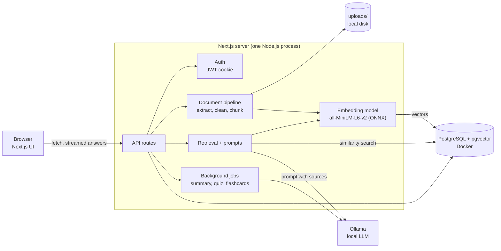

# AI Knowledge Assistant

Upload your documents and chat with them, summarize them, or turn them into
quizzes and flashcards. Everything runs on your own machine: the database, the
embedding model and the language model. No paid APIs, no cloud AI services, and
no document ever leaves your computer.

## Features

- **Accounts**: register, sign in, sign out, edit your profile, change your password.
- **Documents**: drag-and-drop upload of PDF, TXT and Markdown files, with live
  processing status, a per-user storage quota, and a viewer for the extracted text.
- **Semantic search**: documents are split into chunks, embedded locally and
  stored in PostgreSQL with pgvector.
- **Chat**: a ChatGPT-style interface that answers only from your documents,
  streams the answer, cites its sources, and refuses when the documents do not
  contain the answer.
- **Study tools**: summaries, multiple-choice quizzes and flashcards generated
  from a document, saved so you can come back to them.
- **Dashboard**: document, conversation and storage statistics with recent activity.
- **Interface**: responsive layout with a sidebar, dark mode, loading, empty and
  error states.

## Architecture



One Next.js application serves the interface and the API. It talks to two local
services: PostgreSQL (in Docker) and Ollama. The embedding model runs inside the
Next.js process itself.

More detail:

- [Architecture and folder structure](docs/ARCHITECTURE.md)
- [Database design](docs/DATABASE.md)
- [RAG pipeline](docs/RAG-PIPELINE.md)
- [AI features and prompts](docs/AI-FEATURES.md)

## Technology stack

| Area | Technology |
|---|---|
| Frontend | Next.js 15 (App Router), React 19, TypeScript, Tailwind CSS 4, shadcn/ui |
| Backend | Next.js API routes |
| Database | PostgreSQL 16 with pgvector, Prisma ORM |
| Authentication | JWT (`jose`) in an httpOnly cookie, bcrypt password hashing |
| File storage | Local disk (`uploads/`) |
| Embeddings | `all-MiniLM-L6-v2` (sentence-transformers model) via `@huggingface/transformers` |
| Language model | Ollama, `qwen2.5:3b` by default (any Ollama model works) |
| PDF text extraction | `unpdf` |

## Requirements

Install these first:

| Tool | Version | Why |
|---|---|---|
| [Node.js](https://nodejs.org) | 20 or newer | runs the application |
| [Docker Desktop](https://www.docker.com/products/docker-desktop/) | any recent | runs PostgreSQL with pgvector |
| [Ollama](https://ollama.com) | any recent | runs the language model |

About 4 GB of free RAM is enough for the default model. Disk: about 2 GB for the
language model and 90 MB for the embedding model.

## Quick start

```bash
git clone <your-repository-url> ai-knowledge-assistant
cd ai-knowledge-assistant
npm install
ollama pull qwen2.5:3b
npm run setup
npm run dev
```

Open http://localhost:3000 and create an account.

`npm run setup` creates `.env` with a random `JWT_SECRET`, starts the database
container, creates the tables, downloads the embedding model and checks Ollama.
It can be run again at any time and never deletes data.

## Manual setup

The same steps by hand, if you prefer to see each one.

### 1. Install dependencies

```bash
npm install
```

### 2. Create the environment file

```bash
cp .env.example .env
```

Then set `JWT_SECRET` in `.env` to a long random value:

```bash
node -e "console.log(require('crypto').randomBytes(48).toString('base64url'))"
```

### 3. Start the database

```bash
docker compose up -d
```

This starts PostgreSQL 16 with the pgvector extension on `localhost:5433`
(not the default 5432, to avoid clashing with another PostgreSQL). Data is kept
in a Docker volume and survives restarts.

### 4. Create the tables

```bash
npm run db:deploy
```

When you change `prisma/schema.prisma` during development, use
`npm run db:migrate` instead: it creates a new migration and applies it.

### 5. Load the AI models

The language model:

```bash
ollama pull qwen2.5:3b
```

The embedding model (optional; otherwise it downloads on the first upload):

```bash
npm run embeddings:download
```

### 6. Run the application

```bash
npm run dev
```

The start page shows whether PostgreSQL and Ollama are reachable.

For a production build:

```bash
npm run build
npm run start
```

## Environment variables

All settings live in `.env`. Only `JWT_SECRET` has to be set by you; everything
else has a working default. See `.env.example` for the full, commented list.

| Variable | Default | Purpose |
|---|---|---|
| `DATABASE_URL` | `postgresql://aika:…@localhost:5433/aika` | Prisma connection string |
| `POSTGRES_USER`, `POSTGRES_PASSWORD`, `POSTGRES_DB`, `POSTGRES_PORT` | `aika`, …, `aika`, `5433` | used by `docker-compose.yml`; keep in sync with `DATABASE_URL` |
| `JWT_SECRET` | none | signs session tokens; at least 32 characters |
| `OLLAMA_BASE_URL` | `http://localhost:11434` | where Ollama listens |
| `OLLAMA_MODEL` | `qwen2.5:3b` | language model for chat and study tools |
| `OLLAMA_NUM_CTX` | `4096` | context window requested from the model |
| `OLLAMA_MAX_ANSWER_TOKENS` | `512` | longest chat answer |
| `OLLAMA_FIRST_TOKEN_TIMEOUT_S`, `OLLAMA_IDLE_TIMEOUT_S` | `240`, `60` | how long to wait for the model |
| `OLLAMA_KEEP_ALIVE` | `30m` | how long Ollama keeps the model loaded |
| `EMBEDDING_MODEL` | `Xenova/all-MiniLM-L6-v2` | embedding model |
| `EMBEDDING_DIMENSIONS` | `384` | must match the model and the `vector(384)` column |
| `EMBEDDING_CACHE_DIR` | `./.cache/models` | where the embedding model is stored |
| `EMBEDDING_OFFLINE` | `false` | `true` forbids any download by the model loader |
| `RAG_TOP_K` | `6` | chunks retrieved per question |
| `RAG_MIN_SIMILARITY` | `0.3` | below this a chunk counts as irrelevant |
| `RAG_MAX_CONTEXT_TOKENS`, `RAG_MAX_HISTORY_TOKENS` | `1500`, `800` | prompt budgets |
| `UPLOAD_DIR` | `./uploads` | where uploaded files are stored |
| `MAX_UPLOAD_MB` | `20` | largest single file |
| `STORAGE_QUOTA_MB` | `500` | total storage per user |

## Commands

| Command | What it does |
|---|---|
| `npm run setup` | one-command local setup (see above) |
| `npm run dev` | start the development server |
| `npm run build` / `npm run start` | production build and server |
| `npm run lint` / `npm run type-check` | ESLint and TypeScript checks |
| `npm run db:up` / `npm run db:down` | start / stop the database container (data is kept) |
| `npm run db:setup` | start the database and apply migrations |
| `npm run db:migrate` | create and apply a migration after a schema change |
| `npm run db:deploy` | apply existing migrations |
| `npm run db:studio` | browse the database in Prisma Studio |
| `npm run embeddings:download` | download and test the embedding model |
| `npm run embeddings:backfill` | embed documents that are missing vectors |

## Using a different language model

Any model available in Ollama works. Larger models answer better but need more
memory and time.

```bash
ollama pull qwen2.5:7b
```

Then set `OLLAMA_MODEL="qwen2.5:7b"` in `.env` and restart the app.

Changing the **embedding** model is different: vectors from different models
cannot be compared, and the column size is fixed at 384. Stay with a
384-dimension model, then run `npm run embeddings:backfill` to re-embed
existing documents.

## How it works, briefly

1. **Upload**: the file is validated (type, size, quota, actual content), saved
   under `uploads/<userId>/`, and queued.
2. **Process**: text is extracted (per page for PDFs), cleaned, split into chunks
   of about 800 characters with 150 overlap, and each chunk is embedded. The
   status moves `UPLOADED → EXTRACTING → CHUNKING → EMBEDDING → READY`.
3. **Ask**: the question is embedded, pgvector returns the closest chunks from
   your own documents, and they are sent to the model with instructions to
   answer only from them and cite them.
4. **Study**: summaries, quizzes and flashcards run as background jobs with
   progress; quiz answers are double-checked by a second model call.

## Limitations

- Small local models make mistakes. Answers, summaries and quiz keys should be
  checked against the sources shown.
- On CPU, the first token of a chat answer takes roughly 10 seconds and a
  five-question quiz about two minutes.
- Scanned PDFs without a text layer are not supported (no OCR).
- Processing, background jobs and the login rate limiter live in the server's
  memory, so the app is meant to run as a single process.
- `npm audit` reports issues in the bundled build tooling of Next.js 15 and the
  Prisma CLI whose fixes require major-version upgrades.

## Troubleshooting

| Problem | What to do |
|---|---|
| "The database is not reachable" | Start Docker Desktop, then `npm run db:up`. |
| Port 5433 is already in use | Change `POSTGRES_PORT` and the port in `DATABASE_URL` in `.env`, then `npm run db:up`. |
| Port 3000 is already in use | Next.js picks the next free port automatically; use the address it prints. |
| Start page shows Ollama as not reachable | Start Ollama. Check with `ollama list`. |
| "The model … is not installed" | `ollama pull qwen2.5:3b` (or whatever `OLLAMA_MODEL` is set to). |
| Chat is very slow or times out | The model is running on CPU or is short of memory. Close other programs, or raise `OLLAMA_FIRST_TOKEN_TIMEOUT_S`. |
| Docker stops responding | Usually the machine is out of memory. Stop containers you do not need and restart Docker Desktop. |
| A document stays "Failed" | Open it to read the reason, fix the cause, then press Retry. |
| Documents are READY but search finds nothing | Run `npm run embeddings:backfill`. |
| `JWT_SECRET is missing` error | Run `npm run setup`, or set it in `.env` as described above. |
| Signed out after changing `JWT_SECRET` | Expected: old sessions can no longer be verified. Sign in again. |
| First upload is slow or fails offline | The embedding model is downloading. Run `npm run embeddings:download` while online. |
| `prisma generate` fails with EPERM on Windows | Stop the dev server first; it holds the Prisma engine file open. |

## Project structure

```
prisma/            schema and migrations
scripts/           setup, embedding download and backfill
docs/              architecture, database, RAG and AI documentation
uploads/           uploaded files (git-ignored)
src/
  app/             pages and API routes
  components/      UI components, grouped by feature
  lib/             server logic: ai, auth, chat, database, documents, embeddings, rag, tools
  models/          shared types and validation schemas
  middleware.ts    route protection
```
