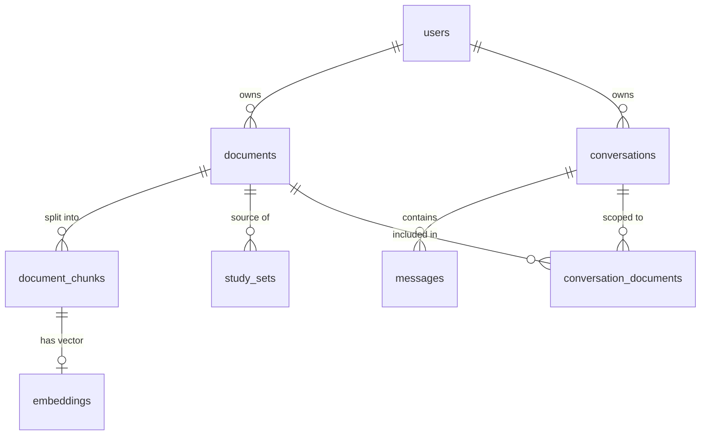

# Database design

PostgreSQL 16 with the pgvector extension, managed through Prisma. The schema is
in [`prisma/schema.prisma`](../prisma/schema.prisma); migrations are in
`prisma/migrations/`.

## Entity relationships



Every delete cascades downwards: deleting a user removes their documents and
conversations; deleting a document removes its chunks, vectors, study sets and
its links to conversations.

## Tables

### `users`

| Column | Type | Notes |
|---|---|---|
| `id` | text (cuid) | primary key |
| `email` | text | unique, stored lower-case |
| `passwordHash` | text | bcrypt, cost 12 |
| `name` | text, nullable | |
| `sessionVersion` | integer | embedded in every JWT; incremented to invalidate sessions |
| `createdAt`, `updatedAt` | timestamp | |

### `documents`

| Column | Type | Notes |
|---|---|---|
| `id` | text (cuid) | primary key |
| `userId` | text | owner |
| `title`, `fileName`, `mimeType`, `sizeBytes` | | file information |
| `storagePath` | text | `<userId>/<documentId>.<ext>`, relative to the upload directory |
| `status` | enum | `UPLOADED`, `EXTRACTING`, `CHUNKING`, `EMBEDDING`, `READY`, `FAILED` |
| `error` | text, nullable | reason shown to the user when `FAILED` |
| `pageCount` | integer, nullable | PDFs only |
| `chunkCount` | integer | |
| `summary` | jsonb, nullable | `{ short, mainPoints[], concepts[], generatedAt, model, coverage }` |
| `suggestedQuestions` | jsonb, nullable | array of three strings |

Index: `(userId, createdAt)` for the document list.

### `document_chunks`

| Column | Type | Notes |
|---|---|---|
| `id` | text (cuid) | primary key |
| `documentId` | text | |
| `index` | integer | position in the document, unique per document |
| `content` | text | up to about 800 characters |
| `tokenCount` | integer | counted by the embedding model's tokenizer |
| `pageNumber` | integer, nullable | page the chunk starts on (PDFs) |

### `embeddings`

| Column | Type | Notes |
|---|---|---|
| `id` | text | primary key |
| `chunkId` | text | unique: one vector per chunk |
| `model` | text | which model produced the vector |
| `vector` | `vector(384)` | unit length |

Chunks and vectors are separate tables so a document can be re-embedded with a
different model without touching its text, and so ordinary queries on chunks
never load 384 numbers per row.

Index: `embeddings_vector_hnsw_idx`, an HNSW index with `vector_cosine_ops`.

### `conversations`

| Column | Type | Notes |
|---|---|---|
| `id` | text (cuid) | primary key |
| `userId` | text | owner |
| `title` | text | set from the first question; can be renamed |
| `allDocuments` | boolean | `true`: search all of the user's documents; `false`: only the linked ones |
| `createdAt`, `updatedAt` | timestamp | `updatedAt` is the time of the last message |

`allDocuments` exists because the linked rows disappear when a document is
deleted. Without the flag, a chat limited to one document would silently start
searching everything once that document was gone.

### `conversation_documents`

Join table `(conversationId, documentId)` for chats limited to chosen documents.

### `messages`

| Column | Type | Notes |
|---|---|---|
| `id` | text (cuid) | primary key |
| `conversationId` | text | |
| `role` | enum | `USER`, `ASSISTANT`, `SYSTEM` |
| `content` | text | |
| `sources` | jsonb, nullable | the passages the answer was based on |

`sources` stores each passage's number, document id and title, page, similarity,
an excerpt and whether it was cited. Keeping a copy with the message means old
conversations still show their sources after the document is deleted.

### `study_sets`

| Column | Type | Notes |
|---|---|---|
| `id` | text (cuid) | primary key |
| `documentId` | text | |
| `type` | enum | `QUIZ`, `FLASHCARDS` |
| `content` | jsonb | `{ questions: [...] }` or `{ cards: [...] }` |

## pgvector with Prisma

Prisma has no vector type, so three things are done by hand:

1. **The column** is declared as `Unsupported("vector(384)")`. Prisma creates it
   but cannot read or write it.
2. **The extension and the index** are added to the first migration's SQL:

   ```sql
   CREATE EXTENSION IF NOT EXISTS vector;
   CREATE INDEX "embeddings_vector_hnsw_idx" ON "embeddings"
     USING hnsw ("vector" vector_cosine_ops);
   ```

   The schema also declares `@@index([vector], map: "embeddings_vector_hnsw_idx")`.
   Prisma cannot describe an HNSW index, but declaring one with the same name
   stops later migrations from trying to drop it.
3. **Reads and writes of vectors** use raw SQL in
   [`src/lib/database/vectors.ts`](../src/lib/database/vectors.ts), always with
   bound parameters.

The similarity query:

```sql
SELECT c.id, d.title, c.content, c."pageNumber",
       1 - (e.vector <=> $1::vector) AS similarity
FROM embeddings e
JOIN document_chunks c ON c.id = e."chunkId"
JOIN documents d ON d.id = c."documentId"
WHERE d."userId" = $2 AND d.status = 'READY' AND e.model = $3
ORDER BY e.vector <=> $1::vector
LIMIT $4;
```

`<=>` is cosine distance, so similarity is one minus it. Ordering by the bare
distance expression lets PostgreSQL use the HNSW index. The query runs with
`SET LOCAL hnsw.iterative_scan = strict_order`: the index returns nearest
neighbours before the `WHERE` clause is applied, and without iterative scanning
a user whose vectors are a small share of the table could get fewer results
than requested.

## Migrations

| Migration | What it does |
|---|---|
| `init` | all tables, the pgvector extension, the HNSW index |
| `add_session_version` | `users.sessionVersion` |
| `conversation_scope` | `conversations.allDocuments` |

Apply them with `npm run db:deploy`. After editing the schema, create a new one
with `npm run db:migrate`.
