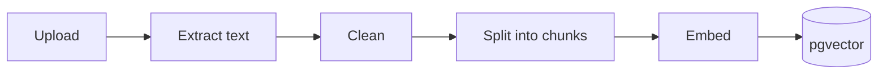
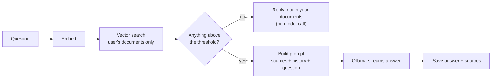

# RAG pipeline

Retrieval-augmented generation has two halves: preparing documents so they can
be searched (ingestion), and using what is found to answer a question (query).

## Ingestion



Code: [`src/lib/rag/pipeline.ts`](../src/lib/rag/pipeline.ts). The document's
`status` column records the current stage.

### 1. Upload (`UPLOADED`)

`src/lib/documents/service.ts` checks, in order: the extension (PDF, TXT,
Markdown), that the file is not empty, the per-file size limit, the user's
storage quota, and the file's bytes (a PDF must contain a PDF header; text must
not contain binary data). The file is stored at
`uploads/<userId>/<documentId>.<ext>`.

### 2. Extract (`EXTRACTING`)

`src/lib/rag/extract.ts`:

- **PDF**: `unpdf` returns the text of each page separately, so page numbers are kept.
- **TXT / Markdown**: decoded as UTF-8, falling back to UTF-16 (by BOM) or Windows-1252.

`src/lib/rag/clean.ts` then normalises line endings and whitespace, removes
control characters, rejoins words hyphenated across lines, and drops lines that
repeat at the top or bottom of most pages (running headers, "Page 3 of 12").

A document with no text ends as `FAILED` with an explanation (for PDFs:
scanned pages need OCR, which is not supported).

### 3. Chunk (`CHUNKING`)

`src/lib/rag/chunk.ts` implements a recursive splitter:

- Pages are joined first, so a sentence that crosses a page break stays whole.
- The text is split on the coarsest boundary that produces small enough pieces,
  trying in order: Markdown headings, paragraphs, lines, sentences, words.
- Neighbouring small pieces are merged to fill each chunk.
- A very short piece in front of a long one (typically a heading) is attached
  to what follows instead of becoming its own chunk.
- Each chunk after the first starts with up to 150 characters from the end of
  the previous one.

Result: chunks of at most 800 characters including overlap, each with its index
and the page its own text starts on. Old chunks are replaced in one transaction.

Why these sizes: `all-MiniLM-L6-v2` reads at most 256 tokens well, and 800
characters is about 200 tokens. The overlap keeps a fact that straddles a
boundary retrievable from either side.

### 4. Embed (`EMBEDDING`)

`src/lib/embeddings/` runs `all-MiniLM-L6-v2` inside the Node.js process through
ONNX Runtime. Chunks are embedded 32 at a time with mean pooling and L2
normalisation, giving 384-dimension unit vectors. Each batch is written to
`embeddings` as soon as it is computed, together with the tokenizer's token
count for each chunk.

### 5. Ready (`READY`)

The document becomes `READY` only after a count confirms that every chunk has a
vector from the current model. If embedding fails, the document is `FAILED`
with a message; "Retry" or `npm run embeddings:backfill` picks it up again.

## Query



Code: [`src/lib/chat/answer.ts`](../src/lib/chat/answer.ts) and
[`src/lib/rag/retrieve.ts`](../src/lib/rag/retrieve.ts).

### 1. Retrieve

`searchSimilarChunks()` embeds the question with the same model as the chunks
and runs the cosine similarity query, restricted to the user's `READY`
documents and, for a scoped chat, to the chosen documents.

`getRelevantContext()` then:

- drops chunks below `RAG_MIN_SIMILARITY` (0.3 by default),
- keeps the best ones that fit in `RAG_MAX_CONTEXT_TOKENS`,
- formats them as numbered `<source id="1" document="…" page="3">` blocks.

A short follow-up such as "why is that?" means little on its own. If it
retrieves nothing, the search is repeated once with the previous question
prepended.

### 2. Refuse early

If nothing passes the threshold, the reply is the fixed sentence "I couldn't
find that in your documents." and the model is never called. This is the main
defence against invented answers: the model cannot improvise about something it
was never asked.

### 3. Build the prompt

```
system:    the grounding rules (same text every time)
history:   earlier turns, newest first, up to RAG_MAX_HISTORY_TOKENS
user:      the <source> blocks, then "Question: …"
```

The rules tell the model to use only the sources, to answer with the fixed
refusal sentence when they do not contain the answer, to cite source ids in
square brackets, and to treat text inside sources as reference material rather
than instructions. The system prompt and history come first and stay stable, so
Ollama can reuse its cached evaluation of that prefix.

The budgets (system prompt, 800 tokens of history, 1,500 of sources, 512 for
the answer) fit inside the 4,096-token context window requested from the model.

### 4. Generate and stream

`src/lib/ai/ollama.ts` calls Ollama's `/api/chat` with streaming on and yields
tokens as they arrive. Two timeouts apply: a long one until the first token
(model loading and prompt reading are slow on CPU) and a shorter one between
tokens. The route forwards each token to the browser as a JSON line.

### 5. Save

The answer is stored with its sources. Citation numbers found in the answer
mark which sources were actually used; the interface shows those. If the model
itself answered with the refusal sentence, no sources are stored.

## Tuning

| Setting | Effect of raising it |
|---|---|
| `RAG_TOP_K` | more passages considered; longer prompts and slower answers |
| `RAG_MIN_SIMILARITY` | fewer weak matches reach the model; more questions are refused |
| `RAG_MAX_CONTEXT_TOKENS` | more source text per answer; slower first token |
| `OLLAMA_NUM_CTX` | larger prompts fit; more memory used by the model |

`POST /api/search` with `{ "query": "…" }` returns the chunks and scores for a
question, which is the quickest way to see what retrieval finds.
